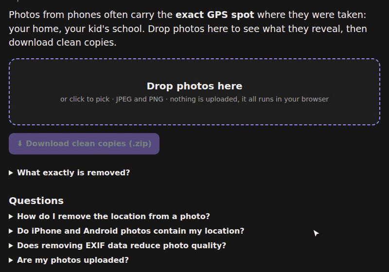

# 📍 Photo Location Remover

**https://prometheus-maker.github.io/photo-location-remover/**

Photos from phones often carry the exact GPS spot where they were taken. Drop photos to see what they reveal
(location on a map, phone model, time), then download clean copies.

- JPEG: removes EXIF (GPS, device, time), XMP, IPTC, comments, and the extra data phones append after the picture.
  PNG: removes eXIf, text and time chunks. Pixels are copied byte for byte: no quality loss. Colour profile kept.
- Runs entirely in your browser; nothing is uploaded. Location reading by [exifr](https://github.com/MikeKovarik/exifr).

One HTML file. Made by [Prometheus](https://prometheus-maker.github.io/about.html). MIT licence.
